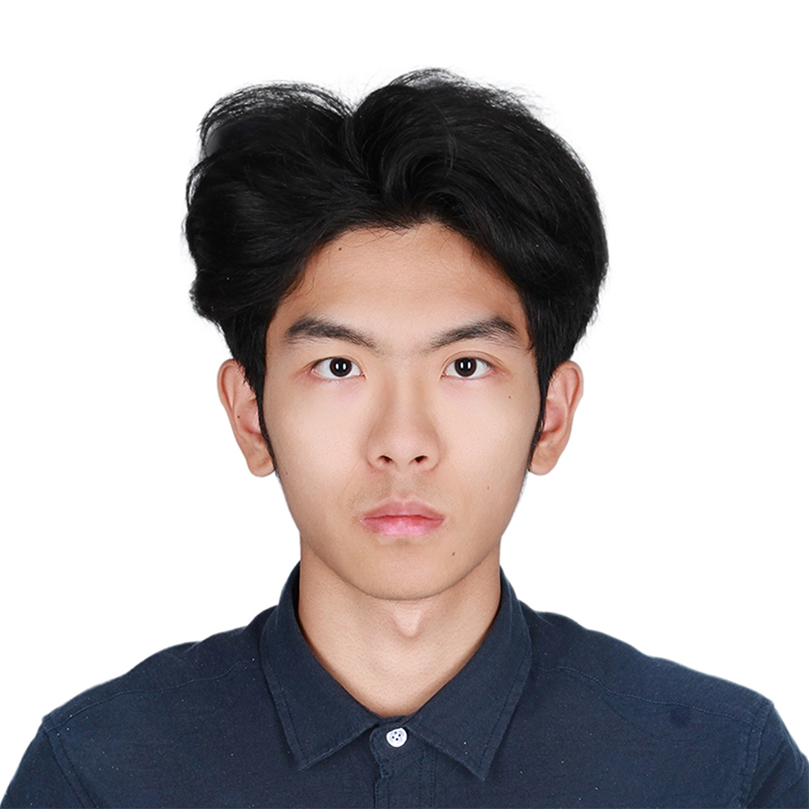

  <section class="profile-hero">
    
    

      <h1>Siqi Chen</h1>
      
Undergraduate Student

      
Tsinghua University

      
<a href="mailto:chensq23@mails.tsinghua.edu.cn">chensq23@mails.tsinghua.edu.cn</a>

      

        <a href="https://github.com/jamescsq47">GitHub</a>
        /
        <a href="/publications/">Publications</a>
        /
        <a href="/activities/">Activities</a>
      

    

  </section>

  <section>
    <h2>About Me</h2>
    

      Hi, I'm Siqi Chen, an undergraduate student in Electronic Engineering at
      <a href="https://www.tsinghua.edu.cn/en/">Tsinghua University</a>.
      My research interests span efficient AI systems, sparse attention mechanisms,
      and brain foundation models.
    

    

      I am currently working on efficient attention and foundation models, with recent
      projects on brain signal modeling, sparse attention for visual generation, and
      distributed systems for long-sequence model acceleration.
    

    

      I welcome collaboration and discussion on AI systems, efficient model inference,
      foundation models, and interdisciplinary applications of machine learning.
    

  </section>

  <section>
    <h2>Picture Options</h2>
    
A few placeholders for recent academic, campus, and sports photos. These can be replaced with real images later.

    

      <figure>
        
Research

        <figcaption>Research discussion / poster session placeholder</figcaption>
      </figure>
      <figure>
        
Campus

        <figcaption>Tsinghua campus life placeholder</figcaption>
      </figure>
      <figure>
        
Track

        <figcaption>Track and field competition placeholder</figcaption>
      </figure>
    

  </section>

  <section>
    <h2>Research Interests</h2>
    
My current research focuses on building efficient, scalable, and useful AI systems. Topics include:

    <ul>
      <li><strong>Efficient AI Systems:</strong> sparse attention, sequence parallelism, workload balancing, and system-level acceleration.</li>
      <li><strong>Efficient Attention:</strong> sparse and quantized attention mechanisms for visual generation and long-context models.</li>
      <li><strong>Brain Foundation Models:</strong> unified modeling of heterogeneous EEG and MEG signals for downstream neural decoding tasks.</li>
    </ul>
  </section>

  <section>
    <h2>News</h2>
    <ul>
      <li><strong>[2026]</strong> db-SP accepted to MLSys 2026.</li>
      <li><strong>[2025]</strong> BrainOmni accepted to NeurIPS 2025.</li>
      <li><strong>[2025]</strong> PAROAttention accepted to NeurIPS 2025.</li>
      <li><strong>[2024-2025]</strong> Received National Scholarship for Undergraduate Students.</li>
      <li><strong>[2024]</strong> Received Dai Yusen Science &amp; Technology Innovation Scholarship.</li>
    </ul>
  </section>

  <section>
    <h2>Education</h2>
    <ul>
      <li>
        <strong>B.S. in Electronic Engineering, Tsinghua University</strong>, Aug. 2023 - Present.
        GPA: 3.94/4.0, Rank: 10/261.
        Selected courses: Digital Logic, Circuits, Programming, Physics, Complex Variables,
        Probability, Linear Algebra, Calculus, and Discrete Mathematics.
      </li>
      <li>
        <strong>Tsinghua University High School</strong>. College Entrance Exam: 700/750.
      </li>
    </ul>
  </section>

  <section>
    <h2>Publications</h2>
    <ol class="compact-publications">
      
      
        <li>
          

            
              <a href="{{ pub.paperurl }}">{{ pub.title }}</a>
            
              <a href="{{ base_path }}{{ pub.url }}">{{ pub.title }}</a>
            
          

          
{{ pub.citation }}

          

            {{ pub.venue }}
            <a href="{{ pub.paperurl }}">Paper</a>
            <a href="{{ base_path }}{{ pub.url }}">Page</a>
          

        </li>
      
    </ol>
  </section>

  <section>
    <h2>Selected Projects</h2>
    <ol>
      <li>
        <strong>Intelligent Voice Assistant</strong> - Arduino + PCB + Python voice assistant
        for email reminders, task scheduling, and study focus.
        <em>Second Award, Hardware Design Competition.</em>
      </li>
      <li>
        <strong>FREE BBS - Tsinghua EE Student Self-Learning Platform</strong> - RAG + AI
        architecture using GLM models, vector databases, and hybrid retrieval for personalized learning.
      </li>
    </ol>
  </section>

  <section>
    <h2>Experience</h2>
    <h3>Research Experience</h3>
    <ol>
      <li>
        <strong>BrainOmni</strong>, advised by Prof. Chao Zhang, Tsinghua EE.
        Topics: brain foundation models, EEG/MEG signal modeling, and downstream neural tasks.
      </li>
      <li>
        <strong>PAROAttention</strong>, advised by Prof. Yu Wang, Tsinghua EE.
        Topics: efficient sparse and quantized attention for visual generation models.
      </li>
      <li>
        <strong>db-SP</strong>, advised by Prof. Yu Wang, Tsinghua EE.
        Topics: sparse attention acceleration, sequence parallelism, and workload balancing.
      </li>
    </ol>
  </section>

  <section>
    <h2>Honors &amp; Awards</h2>
    <ul>
      <li><strong>[2024-2025]</strong> National Scholarship for Undergraduate Students.</li>
      <li><strong>[2024]</strong> Dai Yusen Science &amp; Technology Innovation Scholarship.</li>
      <li><strong>[2024]</strong> Zhihua Integrated Circuit Scholarship.</li>
      <li><strong>[2024]</strong> 1st Prize, National College Student Physics Competition.</li>
      <li><strong>[2024-2025]</strong> Tsinghua Comprehensive Scholarship.</li>
      <li><strong>[2024]</strong> Tsinghua Five-Star Volunteer, highest volunteer honor.</li>
      <li><strong>[2023, 2020]</strong> Outstanding Student of Beijing.</li>
    </ul>
  </section>

  <section>
    <h2>Language</h2>
    <ul>
      <li>TOEFL: 106/120 (Reading 30, Listening 29, Speaking 22, Writing 25).</li>
    </ul>
  </section>

  <section>
    <h2>Miscs</h2>
    <ul>
      <li>I enjoy sports and will keep track and field competition photos in the Activities page.</li>
      <li>Programming languages: C++, C, Python, CUDA, and LaTeX.</li>
      <li>Tools: MATLAB and Typst.</li>
    </ul>
  </section>

